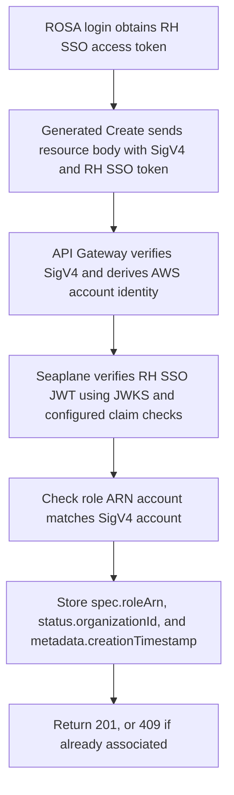

# Cloud discovery role association POC

This POC exposes `POST /api/v0/cloud_discovery/associations`. It creates one
association per AWS account between the account and a customer-supplied IAM
role ARN. It does not yet assume or validate the role with STS.

## Request and identity

The generated client sends a resource-shaped request:

```json
{
  "metadata": {
    "name": "role-association"
  },
  "spec": {
    "roleArn": "arn:aws:iam::123456789012:role/SeaplaneCloudDiscovery"
  }
}
```

The public resource is generated from the internal API type. `client-gen`
generates the typed Create operation, and `bridge-gen` exposes it as
`CloudDiscoveryAssociations().Create(...)`. The client uses the single-segment
resource name `cloud_discovery_associations`; the generated transport adapter
rewrites that segment to `cloud_discovery/associations` before the RH SSO and
SigV4 transports run, preserving the nested route for this and future
cloud-discovery resources. The 201 response is the same resource shape, with
`metadata.creationTimestamp` and `status.organizationId` set by the API.

Run `make generate` in `rosa-seaplane-api` to regenerate the public API types,
clientset, OpenAPI schemas, and pathbind draft. OpenAPI schemas are generated
from the public types; do not edit the generated OpenAPI file by hand. When the
API/clientset candidate is available, ROSA consumes it and runs `make generate`
to refresh its pathbind helpers and mocks.

The route requires two independent credentials:

- API Gateway verifies SigV4 and supplies `X-Amz-Account-Id` and
  `X-Amz-Caller-Arn`.
- The client sends an RH SSO **access token** in
  `X-RH-SSO-Authorization: Bearer <JWT>`. SigV4 remains in the ordinary
  `Authorization` header.

The account ID is derived only from the verified gateway identity; it is not
accepted in the body or URL. The role ARN must be an IAM role in that exact
AWS account. The JWT must have the configured issuer, audience, and `azp`;
`sub`, and an organization claim (`org_id`, `organization.id`, or `rh-org-id`)
are required. The organization claim is persisted as the association's target;
other user identity claims are not stored. No Accounts Management lookup is
performed.

Org-admin enforcement is a functional middleware option. It is disabled on the
association route while testing with a non-admin account. A route that requires
an org admin passes `middleware.WithRHSSOOrgAdminRequired()` to
`NewAWSAndRHSSOJWTMiddleware`, then attaches it with the subrouter's `.Use()`;
the middleware then requires `is_org_admin: true`
before calling its handler.

The decoded ID-token example with `typ: "ID"` is not accepted. Send the normal
bearer access token used by Clusters Service. For migration continuity, the
POC can be configured for `aud=cloud-services` and `azp=cloud-services`.

## RH SSO configuration

Set the following flags (or corresponding environment variables) to enable the
route:

| Flag | Environment variable | Purpose |
| --- | --- | --- |
| `--rh-sso-jwks-url` | `RH_SSO_JWKS_URL` | HTTPS RH SSO certs/JWKS endpoint |
| `--rh-sso-jwks-file` | `RH_SSO_JWKS_FILE` | Local JWKS file; can be used with the URL |
| `--rh-sso-acl-file` | `RH_SSO_ACL_FILE` | UHC-style claim ACL file; an empty file is allowed |
| `--rh-sso-jwt-issuer` | `RH_SSO_JWT_ISSUER` | Exact token `iss` |
| `--rh-sso-jwt-audience` | `RH_SSO_JWT_AUDIENCE` | Required token `aud` |
| `--rh-sso-jwt-azp` | `RH_SSO_JWT_AZP` | Required token `azp` |

The route is not registered if no RH SSO configuration is supplied. Partial or
invalid configuration fails startup. JWKS errors fail closed, including
refresh failures when no local snapshot is configured. The URL is authoritative
when it returns a valid JWKS; the local file is used only if the URL is
unavailable, and its keys are not merged with a healthy URL response. RSA
`RS256` and `RS512` signing keys are accepted.
ACL rules follow UHC semantics: a token is ACL-allowed if any configured rule
matches. Issuer, audience, and authorized-party checks are always mandatory and
cannot be weakened by an empty ACL. Org-admin checking is independently enabled
per route through the middleware option.

## Storage and limits

The record is stored as an internal typed seaplane-db object in
`account-<aws-account-id>`, with a fixed name. The database primary key makes
creation atomic: the first request succeeds; later creates return `409`.
The public collection path currently implements only `POST`; there are no
get/list, update, or delete routes in this POC.

The POC stores the role ARN in `spec`, the organization ID in server-managed
`status`, and the creation time in `metadata.creationTimestamp`. The AWS account
is represented by the account-scoped namespace and label. It does not store RH
SSO user identifiers, JWTs, or AWS credentials. Trust-policy validation, an STS
assume-role check, role rotation, and revocation are future work. The role ARN
is create-only; the POC has no update or delete operation.

## ROSA login and request flow

`rosa login --use-auth-code` uses the OCM CLI OAuth client (`ocm-cli`) with
authorization code + PKCE. The CLI stores the resulting refresh token, then
uses the OCM SDK connection to obtain and persist an access token. The
`rosa link aws-role-association` command sends that **access token**, not the
ID token from the browser's OIDC response. Tokens with a `typ: ID` claim are
rejected. The existing `rosa link ocm-role` command remains the separate OCM
account-management workflow.

Example:

```sh
rosa link aws-role-association \
  --role-arn arn:aws:iam::123456789012:role/SeaplaneCloudDiscovery
```

For this command, ROSA initializes its OCM connection before `WithSeaplane`.
The Seaplane client gets a token source backed by the OCM connection; it obtains
a current access token for each request and adds
`X-RH-SSO-Authorization: Bearer <access-token>` before SigV4 signing. This
preserves `Authorization` for SigV4 and includes the RH SSO header in
`SignedHeaders`. Other Seaplane commands that do not initialize OCM remain
AWS/SigV4-only. `rosa login --seaplane-url` by itself does not perform OCM
login, so this command also requires an OCM login.



* Request headers: `Authorization: AWS4-HMAC-SHA256 ...` carries SigV4;
  `X-RH-SSO-Authorization: Bearer <access-token>` carries RH SSO. Add the RH
  SSO header before SigV4 signing so it is covered by `SignedHeaders`. Do not
  send the AWS account ID in the request body.

The current OCM client login uses `aud=cloud-services`; the POC config must
allow that value during migration. The sample `typ: ID` token is not forwarded:
the client uses the access token issued/refreshed through the OCM SDK connection.

## Validation boundary and token acquisition

The API does not exchange credentials with RH SSO, call token introspection,
or make a live SSO authorization request for each association request. It
validates the access token locally: the JWT signature must verify against a
trusted RH SSO public signing key, and its issuer, audience, authorized party,
time claims, ACL, and organization claims must pass the configured checks.
Org-admin status is additionally required only when the route enables the
middleware option.

The API does retrieve public JWKS keys from the configured RH SSO certs URL at
startup and refresh, using the mounted JWKS file only when that URL is
unavailable. That is key distribution, not per-token validation or token
exchange; no SSO client secret is needed by the API for JWT verification.

Obtaining and refreshing the access token belongs to the caller tooling:
`rosacli`, Terraform, OCM SDK clients, or another client. For example, ROSA CLI
can use browser-based authorization code with PKCE; other clients may use
their supported OAuth flow with a client ID/secret. The client then forwards
the resulting **access token** in `X-RH-SSO-Authorization`. The API only
validates that token; it does not participate in the login or token exchange.
